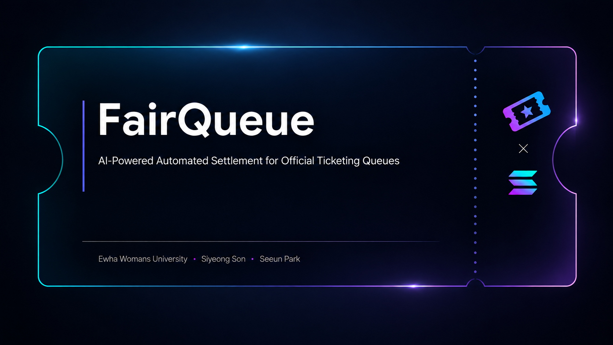

<div align="center">



# FairQueue

### AI-Assisted Ticket Booking and Conditional On-Chain Settlement

**Google Gemini + Solana Anchor Escrow + x402 Agent Payments**

[Try FairQueue](#try-fairqueue) | [Overview](#overview) | [Booking Flow](#booking-flow) | [Architecture](#architecture) | [Tech Stack](#tech-stack) | [Local Setup](#local-setup) | [Transactions](#devnet-transactions) | [Team](#team)

</div>

## Overview

FairQueue is a condition-based ticket booking and payment layer. Buyers describe
the seats they want, review the interpreted conditions, and join the platform
queue. At their turn, the platform selects an offer, checks it against the approved
conditions, and requests the buyer's wallet approval for an escrow deposit followed
by settlement or refund.

FairQueue operates within the platform's queue order rather than bypassing it.
Gemini interprets booking intent; independent code validates the offer and payment
transaction. Funds are handled by the Anchor escrow program on Solana Devnet.

The included platform simulator provides three fictional performances: a concert,
a musical, and a festival. Its storefront presents dates, sections, prices, sale
status, ticket limits, and a seating guide before entering a booking session.
Transactions use Devnet test SOL; KRW values are reference ticket prices.

## Try FairQueue

[Open FairQueue Ticket Storefront](https://fairqueue-storefront-preview-305088341641.asia-northeast3.run.app/storefront/).

The buyer-wallet booking, settlement, and refund flows were tested with the
**Phantom browser extension on Solana Devnet**. Prepare a wallet funded with
Devnet test SOL and unlock the extension before starting.

1. **Sign in.** Create an account, verify your email, and sign in.
2. **Choose a performance.** Explore its seating guide, select a date and ticket
   quantity, and click **Book with FairQueue**. Use **Save event** to revisit it later.
3. **Set your conditions.** Describe preferred seats, a per-ticket budget, and
   ordered alternatives, then click **Interpret request**.
4. **Review and join.** Check the interpreted conditions, connect Phantom, and
   click **Confirm & join queue**.
5. **Approve the deposit.** At your turn, review the quoted Devnet SOL costs and
   approve the deposit in Phantom. The escrow flow then completes settlement or refund.
6. **Check the result.** Open the transaction links on Solana Explorer. In
   **My account**, find booking history, saved events, and recently viewed performances.

## Booking Flow

1. **Sign in.** Create a Firebase account or sign in, and verify your email before
   joining a booking queue.
2. **Browse performances.** Select an event, date, ticket quantity, and optionally
   a preferred section in the storefront.
3. **Describe booking conditions.** Use English or Korean natural language, the
   selection controls, or both.
4. **Review the interpretation.** Gemini structures a primary rule and ordered
   alternatives. The buyer checks sections, price caps, quantity, adjacency,
   split-seat permission, and restricted-view preferences.
5. **Connect your wallet.** Connect a buyer wallet through Wallet Standard on
   Solana Devnet and check its address and test SOL balance.
6. **Join the platform queue.** The buyer waits for the assigned turn. Seat
   parsing does not reserve inventory.
7. **Validate the offer.** At the queue turn, the platform creates a seat hold and
   checks the offer against the approved rules with deterministic code.
8. **Fund the escrow.** In browser-wallet mode, x402 requests an escrow deposit.
   The client validates the transaction, displays its costs, and requests an
   explicit buyer signature. Firebase account mode requires buyer-wallet payments;
   server-funded demo payments are disabled in that mode.
9. **Release or refund.** The authority releases principal to the seller for an
   accepted offer or refunds it to the escrow's buyer address. The result shows
   transaction signatures and Solana Explorer links.
10. **Return to My Account.** Completed settlements and refunds are saved to the
    authenticated user's Firestore booking history. Saved performances and recently
    viewed events are also available in My Account, with browser-local storage.

### Entering Conditions and Alternatives

Use **natural language, the selection controls, or both**. You do not need to
enter the same alternative twice.

| Input method | How to use it |
|:---|:---|
| Natural language only | Describe the first choice and alternatives in the text box. Leave the alternative control unselected; it is not required to confirm alternatives written in the request. |
| Controls only | Leave the text box empty and select a first-choice section, quantity, price cap, and optional alternative. |
| Both | Use controls for details not specified in the text. Explicit natural-language instructions take precedence. |

If the text does not discuss alternatives, the selected alternative control is
retained. If the text explicitly lists alternatives, only those alternatives are
used, in the stated order. Writing **No alternatives** excludes alternatives even
when an alternative is selected in the controls.

The selection controls provide one alternative. Natural-language requests can
express **up to four ordered alternatives**, including three rather than just two.
Each rule can have its own section or grade, per-ticket price cap, adjacency,
split-seat permission, and restricted-view condition. Always check every rule on
the review screen before joining the queue.

### Example with Three Alternatives

```text
Find 2 adjacent R seats, up to KRW 160,000 per ticket.
If unavailable, accept 2 separate R seats at the same price limit.
If neither R option is available, try 2 adjacent S seats,
up to KRW 140,000 per ticket.
If all previous options are unavailable, accept 2 adjacent A seats,
up to KRW 120,000 per ticket.
Avoid restricted-view seats for every option.
Do not accept any other alternatives.
```

For ORBIT/9, this request defines a first choice of adjacent R seats, followed by
three alternatives: separate R seats, adjacent S seats, then adjacent A seats.

## Architecture

```text
Vite / React Ticket Storefront
    |
    v
Booking Session + Gemini Condition Parsing
    |
    v
Express Platform API
    |-- Performance catalog, sale-opening checks and seat inventory
    |-- Platform queue and seat holds
    |-- Deterministic offer verification
    |
    v
Payment Mode
    |-- Account mode: buyer wallet -> HTTP 402 -> validation -> signature
    |                                              -> /x402/settle
    |-- Simulator without account mode: server demo wallet -> /settle
    |
    v
Solana Devnet Anchor Escrow
    |-- deposit: create and fund an escrow PDA
    |-- release: transfer principal to the seller
    |-- refund: return principal to the buyer
    |
    v
Result + Explorer Links + Account Booking History in Firestore
```

The platform API manages the queue, inventory, holds, and orders.
Firebase verifies email/password accounts. The platform validates ID tokens and
uses the authenticated UID for queue ownership, profiles, and Firestore booking
history. Saved and recently viewed events remain browser-local, keyed by UID. Escrow
deposits, releases, and refunds are recorded on-chain.

### x402 Escrow Payments

The buyer-wallet path uses x402 V2 payment headers and the official client SDK
with a custom **`fairqueue-escrow`** scheme for native Devnet SOL deposits.
The HTTP 402 response contains the transaction and its payment requirements.

Before signing, the client checks the buyer, authority, seller, program, escrow
PDA, queue, approved conditions, amount, expiry, and instructions. The server
checks the buyer signature and exact quoted transaction before submission.
Quotes include a fixed compute budget and zero priority fee. A fresh confirmed
blockhash and its context are used for submission; quotes expire within 30 seconds.

Explicit blockhash rejection before broadcast allows cancellation. When submission
or finalization is uncertain, the flow blocks another deposit and offers a payment
status check. Wallet connection alone does not submit a transaction.

### Escrow Costs

The wallet approval screen separates deposit principal, account storage balance,
and the deposit network fee. A principal refund returns the deposited amount to
the buyer; network fees are separate. The storage balance remains in the escrow
account after release or refund. The authority pays the release/refund transaction
fee. The refund demonstration creates a test deposit even when no offer matches.

## Tech Stack

| Area | Technology |
|:---|:---|
| Natural-language conditions | Google Gemini Developer API |
| Offer and transaction verification | Deterministic JavaScript policy checks |
| Storefront | Vite, React, TypeScript, React Router, Lucide icons |
| Booking session and dashboard | HTML, CSS, JavaScript |
| Platform and settlement APIs | Node.js, Express |
| Account authentication | Firebase Authentication, server-side ID token verification |
| Profiles and booking history | Cloud Firestore, Firebase Admin SDK |
| Browser wallet connection | Wallet Standard, Solana transaction signing |
| Agent payment protocol | `@x402/core`, `@x402/fetch`, custom escrow scheme |
| On-chain escrow | Solana Devnet, Anchor, Rust, PDA accounts |
| Solana clients | `@solana/web3.js`, `@coral-xyz/anchor` |
| Container deployment | Docker, Google Cloud Run |
| Tests | Node.js test runner; Playwright browser checks |

## Local Setup

### Prerequisites

- Node.js 22 or later and npm (Firebase Admin SDK requires Node.js 22 or later).
- A Gemini API key and a model available to that API project.
- A backend Solana keypair funded with Devnet SOL for transaction fees.
- For buyer-wallet payments, a separate funded Devnet wallet in a Wallet
  Standard-compatible browser extension. Phantom has been used for verification.

### Install and Build

```bash
git clone --branch main https://github.com/sonsiyeong977/fairqueue.git
cd fairqueue
npm ci
npm --prefix storefront ci
npm --prefix storefront run build
```

### Configure Environment Variables

Create `.env` in the repository root and replace the placeholders:

```env
GEMINI_API_KEY=your_gemini_api_key
GEMINI_MODEL=your_available_gemini_model_id
SOLANA_CLUSTER=devnet
SETTLE_SERVER_URL=http://localhost:4000
SETTLE_API_KEY=your_long_shared_server_secret
X402_ESCROW_ENABLED=true
FIREBASE_PROJECT_ID=fairqueue-511412

# Optional: defaults to ~/.config/solana/id.json
# AGENT_KEYPAIR_PATH=/absolute/path/to/backend-keypair.json

# Optional: seller public address; defaults to the backend wallet
# SELLER_PUBKEY=your_devnet_seller_public_key
```

Both services must use the same `SETTLE_API_KEY`. Keep API keys, keypair files,
and wallet recovery phrases out of source control. The backend keypair acts as
escrow authority; the connected buyer wallet signs its own deposit.

Account setup is described in [Firebase Accounts](docs/ACCOUNT-SETUP.md). Enable
email/password authentication, register the storefront hostname, and configure
server access to the Firebase project. Local Firestore access requires authorized
Application Default Credentials or emulators; the web API key is not a server
credential. The Cloud Run platform runtime uses its service account identity.

### Start Both Services

Terminal 1: settlement API, default port `4000`.

```bash
npm run settle
```

Terminal 2: platform API and storefront, default port `3001`.

```bash
npm run platform
```

Open [Ticket Storefront](http://localhost:3001/storefront/) or
[Demo Dashboard](http://localhost:3001/dashboard/).

Set `PORT` separately for each process to use different ports, and update
`SETTLE_SERVER_URL` accordingly. When the platform runs on Windows and settlement
runs in WSL, use the reachable WSL IP and settlement port for that URL.

### Run a Buyer-Wallet Booking

1. Sign in and verify the account's email address.
2. Enable Solana Devnet in the wallet and fund the buyer with test SOL.
3. Select a performance and review its interpreted booking conditions.
4. Connect the buyer wallet under **My wallet - Devnet**, and check the address and balance.
5. Join the queue, review the deposit costs, and approve the wallet signature
   before the quote expires.
6. Open the deposit and release/refund links on Solana Explorer, then check the
   saved record in My Account.

For a refund demonstration, request one R 1 ticket for the ORBIT/9 November 20
performance with a KRW 100,000 price cap and no alternatives. Its face value is
KRW 154,000, so the request produces a principal refund rather than assigned seats.

### Run Tests

```bash
npm test
```

Automated API and payment-policy tests use mocked chain submission and do not
transfer Devnet SOL. See [Booking and Payment Guide](docs/VER2-BOOKING.md) for
additional integration details.

## Devnet Transactions

Anchor program: [618w9LmnDRNpmrTboeYfWgfgSDaDzghRzA577ciwjJuj](https://explorer.solana.com/address/618w9LmnDRNpmrTboeYfWgfgSDaDzghRzA577ciwjJuj?cluster=devnet).

| Buyer-Wallet Scenario | Deposit | Outcome |
|:---|:---|:---|
| R 1 ticket settlement | [Deposit](https://explorer.solana.com/tx/3uaZxzvbb7pPu7hzBsgWW7eJgEuvmUnQV2PpyyVkT8RpmeTMFguVePST7CxxzTqL37UXTw2kqhtwe3va5YATKFdH?cluster=devnet) | [Release](https://explorer.solana.com/tx/5FnReE467hm5fTCFfKHvia7JcAvSXPEgkftZ79HadT3e3DrkP2knYkc1nkWpyTmZdj28Fof46T7WZzVoqet7JBsg?cluster=devnet) |
| No matching offer at the approved price | [Deposit](https://explorer.solana.com/tx/3oSTLVPvos9b584dbzy6d6QBDyVQXaSatuispFw4mrn9Fv7tgtByAabxkbfizHYMTmpUcFcVPvtCviZmHWS2Mzga?cluster=devnet) | [Refund](https://explorer.solana.com/tx/5MWJk35aEwQvYcL3eeixp6TAyreTKmovhHyzvgroVSZSxUmubtLUh187SCEEZ2bPtdnKuRTFcWYBgFXKBuiDMCE8?cluster=devnet) |

These examples were checked against Devnet transaction records for successful
execution, buyer address, matching order IDs, and principal movement.

## Hosted Storefront

[Open FairQueue Ticket Storefront](https://fairqueue-storefront-preview-305088341641.asia-northeast3.run.app/storefront/).

The Cloud Run preview serves the storefront and platform API from `main` and
connects to a separate settlement service. It uses Firebase Authentication and
Firestore in project `fairqueue-511412` for account profiles and completed booking
history. Sign in, verify your email, and connect a funded Devnet wallet to book.
The events are fictional and transactions use test SOL; this is not real ticket
issuance or a card payment service.

For this deployment, enable `identitytoolkit.googleapis.com` in both the Firebase
project and the Cloud Run project. Give the platform runtime service account
`roles/firebaseauth.viewer` and `roles/datastore.user` on the Firebase project.
Use `FIREBASE_PROJECT_ID=fairqueue-511412` on the platform service and retain its
settlement URL and shared API-key secret configuration. Cloud Run uses its runtime
service account credentials, not a local ADC file.

### Legacy Dashboard

[Open the Cloud Run dashboard](https://fairqueue-dashboard-305088341641.asia-northeast3.run.app/dashboard/).

This is the earlier operator/demo deployment, separate from the authenticated
storefront preview linked above.

## Project Structure

```text
fairqueue/
  agent/                 Settlement API, Anchor adapter and x402 payment handler
  anchor-escrow/         Rust escrow program and Anchor IDL
  dashboard/            Booking session and operator demo dashboard
  platform-sim/         Performance catalog, queue, holds and inventory APIs
  shared/               Client/server escrow payment policy
  storefront/           Vite + React + TypeScript ticket storefront
  tests/                API and payment-policy tests
  docs/                 Integration documentation and screenshots
  Dockerfile            Node.js deployment container
  start.js              Platform/settlement service entry point
```

## Team

| Name | Role |
|:---|:---|
| Seeun Park | PM · Frontend · UI/UX · Auth · Integration |
| Siyeong Son | PM · Backend · AI · On-chain |
